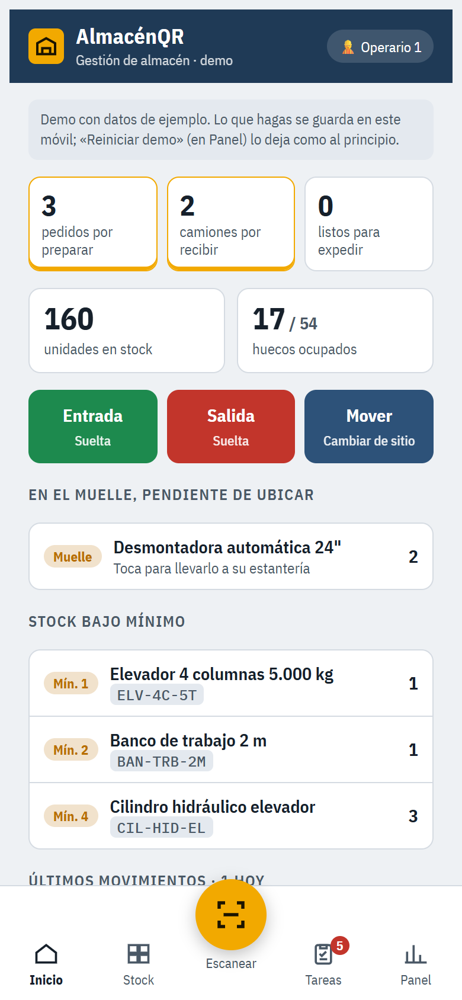
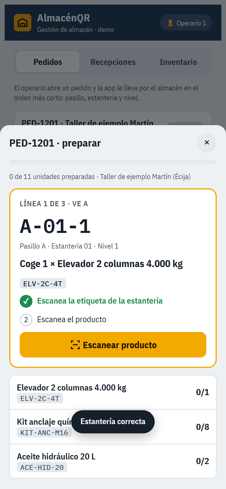
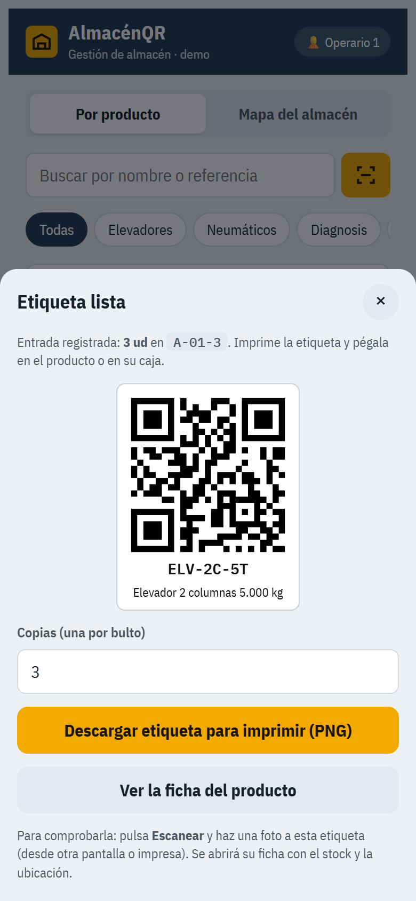
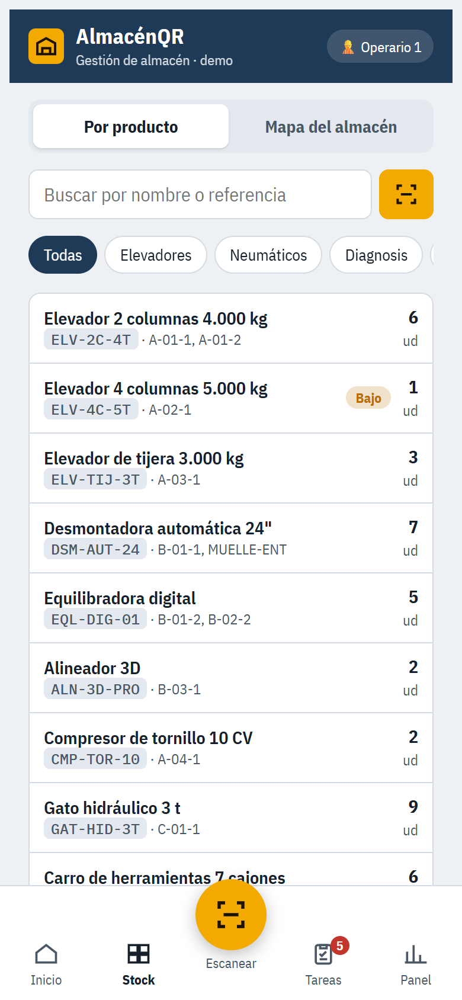
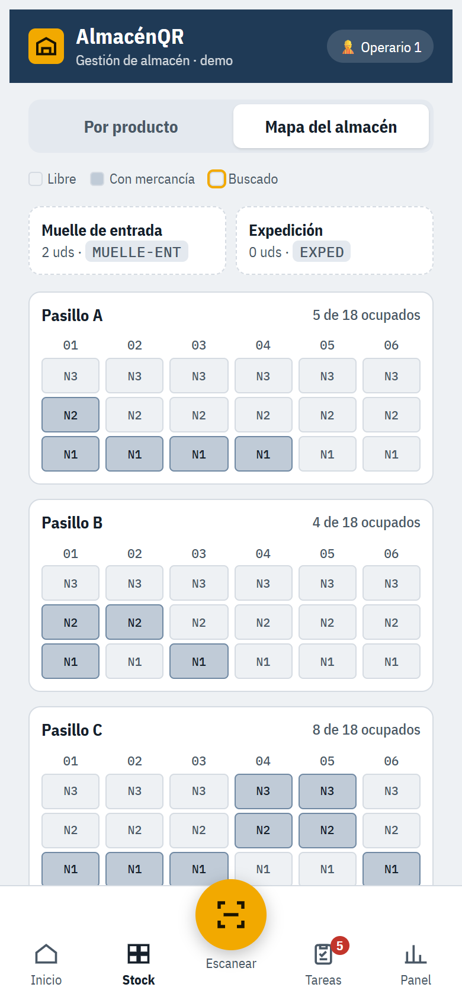
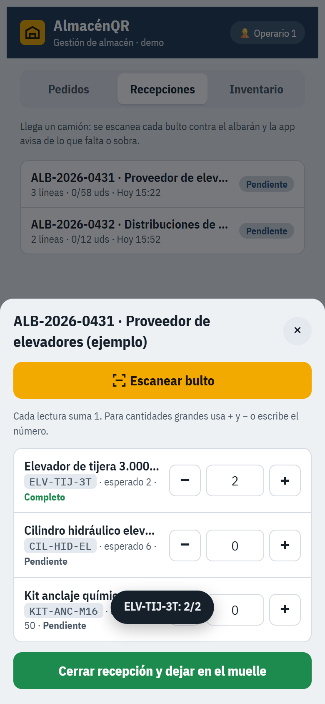
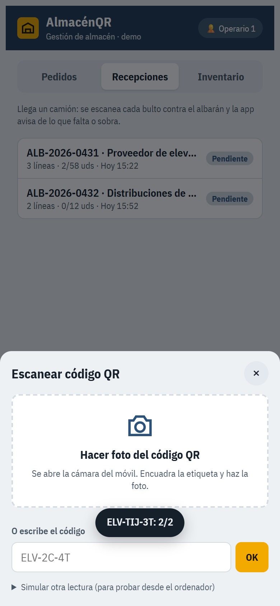
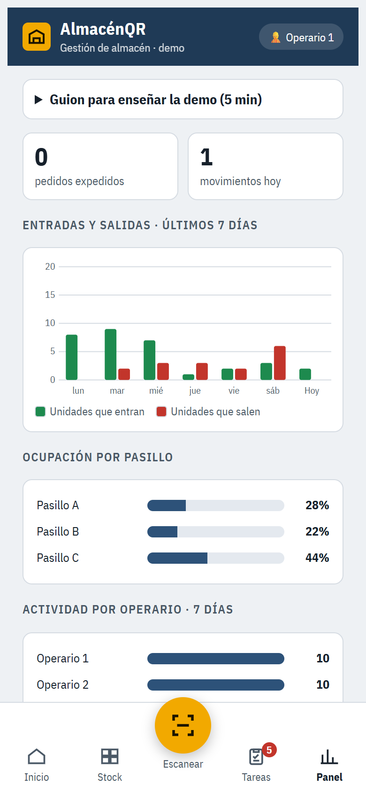
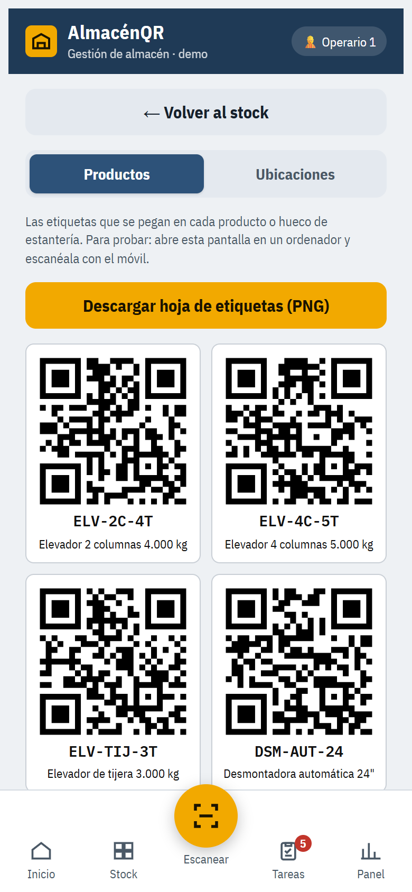
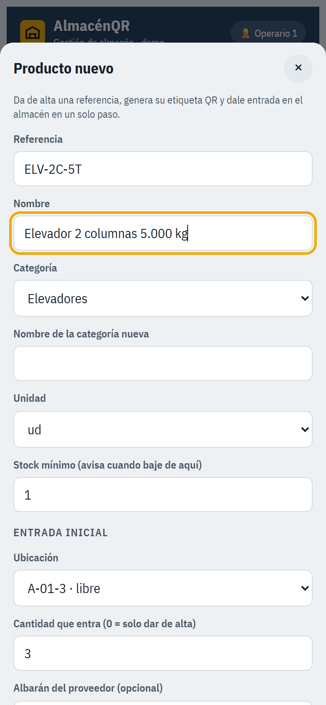

# AlmacénQR · Gestión de almacén con códigos QR

[](https://github.com/davidmobe97/almacenqr/actions/workflows/test.yml)

Demo de un **programa de gestión de almacén (SGA)** pensado para el móvil o la PDA del operario:
entradas, salidas, ubicaciones, preparación de pedidos, recepción de camiones, inventario y
etiquetas QR. Es una **PWA**: se instala en el móvil como una app, funciona sin cobertura y lee los
QR con la cámara.

**▶ Probar la demo:** https://davidmobe97.github.io/almacenqr/

> Ábrela en el móvil y, en el ordenador, ve a **Stock → Etiquetas QR**. Escanea las etiquetas de la
> pantalla con el botón amarillo. Si no tienes otro dispositivo, cada paso tiene el botón
> «Demo: simular lectura».

<p>
  
  
  
</p>

## Qué hace

| Flujo | Cómo funciona |
|---|---|
| **Preparar pedidos** | Ordena las líneas por pasillo, estantería y nivel. El operario escanea la estantería y después el producto; si se equivoca de hueco o de referencia, le avisa al momento. Al terminar, la mercancía pasa a *Expedición* y se registra la salida. |
| **Recibir camiones** | Cada lectura suma un bulto al albarán. Al cerrar, compara lo recibido con lo esperado («faltan 5», «sobran 2»), deja la mercancía en el muelle y registra la incidencia. |
| **Inventario a ciegas** | El operario cuenta un hueco sin ver lo que dice el sistema. La app compara y, si hay diferencias, genera un movimiento de ajuste. |
| **Producto nuevo** | Alta de la referencia, etiqueta QR al momento (una copia por bulto, en PNG para imprimir) y entrada inicial en su ubicación, en un solo paso. |
| **Entradas, salidas y movimientos** | Operaciones sueltas con escaneo de producto y ubicación, control de stock disponible y número de albarán o pedido. |
| **Stock y mapa** | Búsqueda por nombre o referencia, filtro por categoría, avisos de stock bajo mínimo y mapa de pasillos con los huecos ocupados. |
| **Panel** | Gráfica de entradas y salidas de 7 días, ocupación por pasillo, actividad por operario, historial filtrable y exportación a Excel (CSV). |

<details>
<summary>Más capturas</summary>
<p>
  
  
  
  
  
  
  
</p>
</details>

## Tecnología

- **HTML, CSS y JavaScript sin frameworks**, en un solo archivo (`index.html`) para que la demo cargue al instante en cualquier móvil.
- **Lectura de QR**: cámara en directo con `getUserMedia` y [jsQR](https://github.com/cozmo/jsQR). Si el navegador no da acceso a la cámara, se puede leer desde una foto.
- **Generación de QR**: [qrcode-generator](https://github.com/kazuhikoarase/qrcode-generator). Las etiquetas se pintan en un `canvas` y se descargan en PNG.
- **PWA**: `manifest.webmanifest` y un *service worker* (`sw.js`) que usa primero la red y, si no hay conexión, la copia guardada.
- **Datos**: `localStorage` del dispositivo, con datos de ejemplo que se pueden reiniciar.
- **Tests**: 9 pruebas de flujo completas con [jsdom](https://github.com/jsdom/jsdom) y `node:assert`, que se ejecutan en cada push con **GitHub Actions**.
- **Accesibilidad**: navegación con roles ARIA, mensajes `role="status"`, botones grandes para usar con guantes y vibración al leer un código.

Formato de las etiquetas: `AQR:P:<referencia>` para productos y `AQR:U:<ubicación>` para huecos
(por ejemplo, `AQR:U:A-01-2` = pasillo A, estantería 01, nivel 2).

## Ejecutar en local

```bash
npm install
npm test        # 9 pruebas de flujo
npm start       # sirve la carpeta en http://localhost:3000
```

La cámara necesita HTTPS o `localhost`.

## Hacia una versión en producción

Esta demo funciona entera en el navegador. La versión para un almacén real está planteada así:

- **API en ASP.NET Core (C#)** con PostgreSQL o SQL Server: stock compartido, usuarios y permisos.
- **Frontend en Angular** como PWA para PDAs Android, con **SignalR** para ver los cambios en tiempo real.
- **Impresión directa** en impresoras de etiquetas Zebra (ZPL).
- **Conexión con la tienda online** (WordPress/WooCommerce) para publicar el stock disponible.

---

© 2026 David Molero Berrocal · [Portfolio](https://davidmobe97.github.io) · [LinkedIn](https://www.linkedin.com/in/david-molero-berrocal)
Código publicado como muestra de trabajo. Consulta la [licencia](LICENSE).
